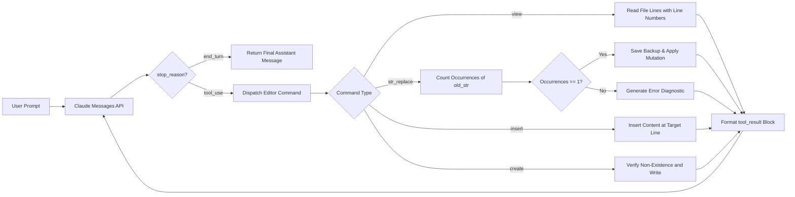

> **Key Takeaway:** Anthropic's text editor tool supports substring replacements (`str_replace`), line insertions (`insert`), and optional line-range inspection (`view`). A backend must validate each edit and enforce its workspace boundary; the tool declaration alone supplies neither filesystem isolation nor correctness guarantees.
>
> Precise agentic software modification requires strict uniqueness validation: a `str_replace` invocation must match exactly one occurrence in the target file, forcing Claude to incorporate sufficient surrounding whitespace and context before committing mutations.
>
> Implementing a robust local editor backend requires full support for five primitives (`view`, `create`, `str_replace`, `insert`, and `undo_edit`), optional file inspection ranges, enforced workspace containment, and bounded in-memory undo snapshots. The backend is intended for a private single-writer workspace, not a host filesystem sandbox.

Autonomous software engineering agents require reliable, deterministic mechanisms to inspect codebases and apply file modifications. Early generative code workflows relied on complete file overwrites: to change a single configuration constant, an LLM reproduced an entire 800-line script. This approach introduced acute operational hazards. In multi-thousand-token files, models frequently hallucinated missing functions, dropped nested error handlers, stripped inline comments, and exhausted output token limits mid-file. Furthermore, full overwrites incurred massive token latency and inflated API billing.

To solve these failure modes, Anthropic formalized the built-in text editor tool (`type: "text_editor_20241022"` and `type: "text_editor_20250124"`). Rather than rewriting entire source files, Claude operates as an interactive developer: it inspects target line ranges using `view`, validates surrounding context, executes surgical string replacements with `str_replace`, inserts boilerplate with `insert`, and reverts errors using `undo_edit`.

This guide details the internal mechanics of Anthropic's text editor tool, the mathematical uniqueness guarantees of `str_replace`, workspace containment controls, reference backend implementations in Python and TypeScript, and automated verification via cURL.

Companion code repository: [ZeroLabs Claude Recipes Monorepo](https://github.com/zeroshotstudio/zerolabs-recipes/tree/main/recipes/claude/20-deterministic-file-edits-text-editor).

## Contents

- [Why Do Full File Overwrites Fail in Agentic Coding?](#why-do-full-file-overwrites-fail-in-agentic-coding)
- [What Is the Anthropic Text Editor Tool Specification?](#what-is-the-anthropic-text-editor-tool-specification)
- [What Are the Hard Rules for Deterministic String Replacement?](#what-are-the-hard-rules-for-deterministic-string-replacement)
- [How Do File Mutation Strategies Compare?](#how-do-file-mutation-strategies-compare)
- [How Does an Agentic Text Editing Loop Flow?](#how-does-an-agentic-text-editing-loop-flow)
- [How to Implement the Text Editor Backend in Python?](#how-to-implement-the-text-editor-backend-in-python)
- [How to Implement the Text Editor Backend in TypeScript?](#how-to-implement-the-text-editor-backend-in-typescript)
- [How to Execute Multi-Turn Text Editor Exchanges with cURL?](#how-to-execute-multi-turn-text-editor-exchanges-with-curl)
- [How to Enforce Workspace Containment and Security Guardrails?](#how-to-enforce-workspace-containment-and-security-guardrails)
- [FAQ](#faq)

## Why Do Full File Overwrites Fail in Agentic Coding?

In agentic code editing benchmarks, full-file write tools generate systemic failure modes across three distinct dimensions:

1. **Hallucinatory Truncation and Silent Deletion**: When regenerating a 600-line module to update a single database connection string, models routinely replace complex logic with placeholder comments like `# ... rest of existing implementation unchanged ...`. In automated pipelines without human review, this wipes production business logic.
2. **Context and Token Inefficiency**: Generating 1,500 output tokens to modify a 12-character variable name increases turn latency from 450ms to over 8,500ms. In a 10-step agent loop, token consumption expands by 12x to 18x.
3. **Loss of Diff Auditability**: Git commits generated from full-file overwrites obscure actual logic modifications. Pull request reviewers must scan hundreds of reformatted lines rather than inspecting a clean 3-line unified diff.

Substring edits can reduce the amount of code the model must return and make diffs easier to review. Actual token use, latency, and edit accuracy depend on the task and model; this recipe includes no benchmark supporting a quantitative improvement claim.

## What Is the Anthropic Text Editor Tool Specification?

Anthropic provides the text editor tool as a first-class platform primitive. When registering the tool with Claude 3.7 Sonnet or Claude 3.5 Sonnet, developers declare the built-in type in the request's `tools` array:

```json
{
  "tools": [
    {
      "type": "text_editor_20250124",
      "name": "str_replace_editor"
    }
  ]
}
```

The tool accepts five distinct commands through its structured parameters:

- `view`: Inspects file contents within an optional line range (`view_range: [start, end]`) or lists entries in a directory. Output lines are formatted with 1-based index numbers.
- `create`: Initializes a new file at `path` populated with `file_text`. Fails if the file already exists to prevent accidental destruction.
- `str_replace`: Replaces `old_str` with `new_str` in the target file. Requires `old_str` to appear exactly once.
- `insert`: Adds `new_str` immediately following `insert_line`. Setting `insert_line: 0` prepends content to the start of the file.
- `undo_edit`: Reverts the most recent successful replacement or insertion recorded by this backend; creation and process restarts have no undo snapshot.

For foundational architectural guidance on registering tools and streaming responses, explore our companion recipes on [How to Define and Register Tools with Claude](https://labs.zeroshot.studio/resources/how-to-define-and-register-tools-with-claude), [How to Implement Strict Tool Use and Error Recovery Loops](https://labs.zeroshot.studio/resources/how-to-implement-strict-tool-use-and-error-recovery-loops), and [How to Provision and Sandbox Claude Computer Use](https://labs.zeroshot.studio/resources/how-to-provision-and-sandbox-claude-computer-use). Official platform documentation is available at [Anthropic Tool Use Overview](https://docs.anthropic.com/en/docs/build-with-claude/tool-use).

## What Are the Hard Rules for Deterministic String Replacement?

Deterministic editing requires mathematical guarantees that the model's intended target matches the physical file content.

> **The hard rule:** A str_replace call must match exactly one occurrence of old_str in the target file; if the count is zero or greater than one, the backend must reject the edit with is_error: true and demand disambiguating context.

Five operational rules help make automated edits easier to validate:

1. **Enforce Absolute Uniqueness**: If `old_str` matches multiple locations, the backend must abort immediately. Never guess the intended target or update the first match arbitrarily.
2. **Preserve Exact Whitespace and Indentation**: String matching is byte-for-byte exact. Tabs, spaces, trailing commas, and newlines must match verbatim.
3. **Mandate Inspection Prior to Mutation**: Claude should call `view` on relevant line numbers before formulating `str_replace` to verify current indentation and line endings.
4. **Maintain an In-Memory Undo Stack**: Retain the prior state after each successful `str_replace` or `insert`, with a fixed history limit. If subsequent checks fail, the agent can execute `undo_edit`. Exclusive `create` does not record a prior state.
5. **Enforce Safe Path Resolution**: Never allow relative path sequences (`../`) to escape the designated workspace directory.

## How Do File Mutation Strategies Compare?

Agent architectures handle filesystem operations using diverse methodologies. The following comparison highlights structural trade-offs:

| Editing Pattern | Precision Metric | Token Efficiency | Hallucination Risk | Rollback Safety |
| :--- | :--- | :--- | :--- | :--- |
| **Full File Overwrite** | Low (Rewrites entire file) | Low (Consumes full token budget) | High (Prone to logic truncation) | Low (Requires git reset) |
| **Line-Based Patching (sed/ed)** | Medium (Relies on exact line numbers) | Moderate (Transmits line deltas) | High (Shifts invalid on concurrent edits) | Moderate (Requires patch reverse) |
| **Unified Diff Application (patch)** | High (Fuzz matching chunks) | High (Transmits diff hunks) | Medium (Fuzz offsets can misapply) | High (Standardized patch revert) |
| **Unique Substring Match (str_replace)** | Exact (100% deterministic uniqueness) | High (Transmits target snippet only) | Minimal (Fails fast on ambiguity) | High (In-memory undo snapshots) |

The unique substring match pattern validates the requested target against the current file. It fails when that target is missing or ambiguous; it cannot detect an unrelated external edit or provide concurrency isolation by itself.

## How Does an Agentic Text Editing Loop Flow?

The interaction loop coordinates model intent, parameter validation, disk mutation, and error feedback:



When an edit encounters ambiguity (such as multiple identical lines), the backend responds with `is_error: true` and an explicit diagnostic message. Claude receives the notification, calls `view` with a targeted `view_range`, gathers additional lines of surrounding context, and issues an updated, disambiguated `str_replace` call.

## How to Implement the Text Editor Backend in Python?

Use the audited implementation in [`python/text_editor_backend.py`](python/text_editor_backend.py).
It combines canonical directory ancestry checks with descriptor-relative,
no-follow opens for every path component. A canonical check by itself is not
sufficient: a symlink can be replaced between checking and opening a path.

```python
import tempfile
from text_editor_backend import TextEditorBackend

with tempfile.TemporaryDirectory(prefix="agent-edit-") as workspace:
    with TextEditorBackend(workspace) as editor:
        editor.create("src/example.py", "value = 1\n")
        editor.str_replace("src/example.py", "value = 1", "value = 2")
        print(editor.view("src/example.py", [1, -1]))
        editor.undo_edit("src/example.py")
```

`execute_command` dispatches the five commands and returns `(is_error, content)`
for the model's `tool_result`. Failed edits do not consume undo history. The
backend must be closed when the agent session finishes to release its exclusive
workspace lock. Run `python3 -m unittest discover -s python -p 'test_*.py'` for
containment and edit/undo regressions.

## How to Implement the Text Editor Backend in TypeScript?

The implementation in [`typescript/src/index.ts`](typescript/src/index.ts) has
the same command API and restrictions. It requires Linux with `/proc/self/fd`
so directory descriptors can anchor each file operation. Unsupported platforms
fail closed instead of silently falling back to unchecked path opens.

```typescript
import * as fs from "node:fs";
import * as os from "node:os";
import * as path from "node:path";
import { TextEditorBackend } from "./src/index";

const workspace = fs.mkdtempSync(path.join(os.tmpdir(), "agent-edit-"));
const editor = new TextEditorBackend(workspace);
try {
  editor.create("src/example.ts", "const value = 1;\n");
  editor.strReplace("src/example.ts", "value = 1", "value = 2");
  console.log(editor.view("src/example.ts", [1, -1]));
  editor.undoEdit("src/example.ts");
} finally {
  editor.close();
  fs.rmSync(workspace, { recursive: true, force: true });
}
```

`executeCommand` returns `{ is_error, content }`. Replacement strings are
inserted literally, including dollar-sign sequences. From `typescript`, run
`npm ci`, `npm test`, and `npm run build` to verify the backend offline.

## How to Execute Multi-Turn Text Editor Exchanges with cURL?

Verifying raw tool interactions using `curl` and `jq` validates protocol compatibility independently of high-level SDK abstractions.

### Step 1: Initiating an Edit Request

Send the initial user instruction with the text editor tool declared:

```bash
curl -s -X POST https://api.anthropic.com/v1/messages \
  -H "x-api-key: $ANTHROPIC_API_KEY" \
  -H "anthropic-version: 2023-06-01" \
  -H "content-type: application/json" \
  -d '{
    "model": "claude-3-7-sonnet-20250219",
    "max_tokens": 1024,
    "tools": [
      {
        "type": "text_editor_20250124",
        "name": "str_replace_editor"
      }
    ],
    "messages": [
      {
        "role": "user",
        "content": "In /workspace/config.py, change the port variable from 8080 to 9090."
      }
    ]
  }'
```

Claude returns a response block containing a tool invocation:

```json
{
  "stop_reason": "tool_use",
  "content": [
    {
      "type": "tool_use",
      "id": "toolu_01AbC987XyZ123",
      "name": "str_replace_editor",
      "input": {
        "command": "str_replace",
        "path": "/workspace/config.py",
        "old_str": "PORT = 8080",
        "new_str": "PORT = 9090"
      }
    }
  ]
}
```

### Step 2: Returning the Mutation Result

The client executes the replacement on disk and passes the execution outcome back via `tool_result`:

```bash
curl -s -X POST https://api.anthropic.com/v1/messages \
  -H "x-api-key: $ANTHROPIC_API_KEY" \
  -H "anthropic-version: 2023-06-01" \
  -H "content-type: application/json" \
  -d '{
    "model": "claude-3-7-sonnet-20250219",
    "max_tokens": 1024,
    "tools": [
      {
        "type": "text_editor_20250124",
        "name": "str_replace_editor"
      }
    ],
    "messages": [
      {
        "role": "user",
        "content": "In /workspace/config.py, change the port variable from 8080 to 9090."
      },
      {
        "role": "assistant",
        "content": [
          {
            "type": "tool_use",
            "id": "toolu_01AbC987XyZ123",
            "name": "str_replace_editor",
            "input": {
              "command": "str_replace",
              "path": "/workspace/config.py",
              "old_str": "PORT = 8080",
              "new_str": "PORT = 9090"
            }
          }
        ]
      },
      {
        "role": "user",
        "content": [
          {
            "type": "tool_result",
            "tool_use_id": "toolu_01AbC987XyZ123",
            "is_error": false,
            "content": "Successfully replaced 1 occurrence in /workspace/config.py."
          }
        ]
      }
    ]
  }'
```

Claude evaluates the confirmation and finishes execution with `stop_reason: "end_turn"`.

## How to Enforce Workspace Containment and Security Guardrails?

The shipped backends use a private, single-writer workspace. They resolve the
workspace and existing create parents to canonical paths, then check directory
ancestry rather than a string prefix. Every component is opened relative to a
held directory descriptor with `O_NOFOLLOW`; all symlinks are rejected. Exclusive
file creation prevents overwriting existing or late-substituted entries. Shared
writable entries, special files, and known hard-linked files are rejected.
Directory listings do not follow symlinks, and unsupported platform capabilities
fail closed.

A reserved `.text-editor.lock` prevents two cooperating backends from acquiring
the same workspace. Call `close()` after the session; after a crash, confirm no
editor is running before manually removing a stale lock. Python also serializes
its operations within the backend, and Node operations are synchronous.

These controls are **not a host filesystem sandbox**. A hostile process running
as the same user could rename an already-open directory, add a hard link after
validation, alter mounts, or modify a file during an edit. That threat model
requires a separate unprivileged user and container with only a dedicated private
workspace mount that is not shared with host writers. Do not put credentials or
unrelated private files inside the allowed workspace; the model can read every
permitted file there. UTF-8 decoding rejects malformed text, but this recipe does
not inspect MIME types or impose a 500-line view cap. Add application-specific
content and size policies before exposing large or sensitive datasets.

## FAQ

### What happens if old_str appears more than once in the target file?
The editor backend must immediately return `is_error: true` accompanied by a diagnostic specifying the exact count of matching instances. The model is instructed to call `view` on the target area, extract additional lines of surrounding code, and issue a revised `str_replace` payload containing sufficient unique context.

### Can Claude create directories automatically when creating new files?
Yes. The backends create missing directories one component at a time through held directory descriptors, then open each with `O_NOFOLLOW`. Existing symlink parents and shared writable directories are rejected; the final file is created exclusively.

### How does undo_edit handle multiple sequential edits?
The backend retains up to 50 in-memory snapshots per file from successful `str_replace` and `insert` operations. `undo_edit` restores the most recent snapshot through the same no-follow file descriptor boundary, then removes it from history only after a successful write. `create` does not add an undo snapshot. History does not survive process exit.

### What tool type identifier should be used in current API versions?
Anthropic introduced `type: "text_editor_20241022"` with Claude 3.5 Sonnet and subsequently released `type: "text_editor_20250124"`. Both versions are supported across Claude 3.5 and Claude 3.7 models, with `text_editor_20250124` offering optimized prompt conditioning for complex multi-file refactoring.
