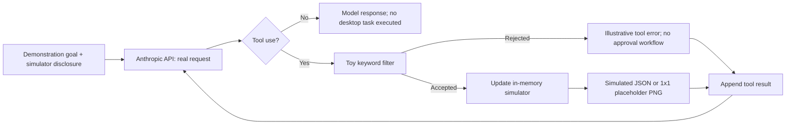

# Computer Use Protocol Simulator and Sandbox Design Notes

This recipe demonstrates Computer Use message handling with Python and
TypeScript **protocol simulators**. The code records actions in memory and
returns a transparent **1×1 placeholder PNG**. It does not provision Xvfb,
Fluxbox, a container, a browser, an input driver, a network filter, or a human
approval workflow. No desktop task is executed.

The live examples send real Anthropic requests and may incur usage charges.
Their initial user message and screenshot text identify the simulated behavior;
all action results include `simulated: true`. The toy keyword filter illustrates
a rejected tool result and supplies no security guarantee.

Companion code: [Recipe 21](README.md).

## What the protocol loop demonstrates

The historical `computer_20250124` schema registers a tool named `computer`
with nominal display dimensions:

```json
{
  "type": "computer_20250124",
  "name": "computer",
  "display_width_px": 1024,
  "display_height_px": 768,
  "display_number": 1
}
```

Those values describe simulated coordinates. They are not evidence of a running
display, and the placeholder image does not match that nominal resolution.
The example's model and beta version are historical defaults; verify current
provider support before selecting a compatible model/tool pair for live calls.

When the model returns a `tool_use` block, the simulator records its action and
returns a `tool_result`. Cursor movement updates two numbers. Clicks and
keystrokes report simulated status. Screenshots return a placeholder image with
an explicit text disclosure. Unsupported actions report `unsupported_action`.



The loop stops after five API turns by default. This limit bounds rounds of
model requests; it does not provide a desktop action timeout or OS resource
control. Run the [offline smoke checks](README.md#offline-checks) to exercise
the simulator without an API key or paid request.

## Why an actual desktop needs its own boundary

A real desktop driver can act with the privileges of the account running it.
That account may have browser sessions, files or network access that the model
could misuse. Prompt injection and accidental clicks can affect those resources.
Concurrent human input and mismatched screenshot dimensions can also make a
desktop workflow unreliable.

This recipe does not measure reliability, latency, completion rates, or token
savings. Select display dimensions based on the current provider documentation
and test coordinate transforms against the actual captured images. Neither
choosing a resolution nor naming a component a gateway establishes safety.

## Illustrative, unvalidated Xvfb/Fluxbox container snippets

The following Dockerfile and entrypoint are retained as **design sketches**.
They have not been built or validated by this recipe's acceptance checks. No
Dockerfile or entrypoint is shipped in the recipe, and its simulators do not
connect to the desktop shown here. These snippets are not a hardened deployment
or a complete application.

```dockerfile
FROM ubuntu:24.04

ENV DEBIAN_FRONTEND=noninteractive
ENV DISPLAY=:1
ENV DISPLAY_WIDTH=1024
ENV DISPLAY_HEIGHT=768

RUN apt-get update && apt-get install -y --no-install-recommends \
    xvfb \
    fluxbox \
    xdotool \
    scrot \
    net-tools \
    curl \
    ca-certificates \
    python3 \
    python3-pip \
    && rm -rf /var/lib/apt/lists/*

RUN useradd -m -s /bin/bash sandboxuser
USER sandboxuser
WORKDIR /home/sandboxuser

RUN mkdir -p /home/sandboxuser/.fluxbox

COPY --chown=sandboxuser:sandboxuser entrypoint.sh /home/sandboxuser/entrypoint.sh
RUN chmod +x /home/sandboxuser/entrypoint.sh

ENTRYPOINT ["/home/sandboxuser/entrypoint.sh"]
```

Illustrative `entrypoint.sh`:

```bash
#!/usr/bin/env bash
set -euo pipefail

Xvfb :1 -screen 0 "${DISPLAY_WIDTH}x${DISPLAY_HEIGHT}x24" &
XVFB_PID=$!

# Sketch only: a real entrypoint needs readiness checks and child cleanup.
sleep 1
fluxbox &

echo "Illustrative X11 display :1 (${DISPLAY_WIDTH}x${DISPLAY_HEIGHT})"
wait "${XVFB_PID}"
```

The sketches start X11 processes only. They do not implement screenshot/input
dispatch, process supervision, network filtering, credential management,
resource limits, or approval handling. Running as a non-root user inside a
container is distinct from running a rootless container engine, and neither
alone proves the isolation required for a particular threat model.

## Illustrative container and network controls

This unvalidated launch sketch may help identify settings to investigate:

```bash
docker run --rm -d \
  --name claude-sandbox \
  --read-only \
  --tmpfs /tmp:rw,noexec,nosuid,size=256m \
  --cap-drop=ALL \
  --user 1000:1000 \
  -e DISPLAY=:1 \
  claude-computer-sandbox:latest
```

The image would need to be built separately. This command has no egress
restriction, no memory/CPU/PID limits, no driver, and no human approval system.
Its read-only paths must be tested against the chosen desktop processes. It
does not make the code above a deployed sandbox.

A filtering proxy could use a destination list such as the following, but a
list alone enforces nothing:

```text
.github.com
.npmjs.org
.python.org
```

A real implementation must install the proxy/firewall policy, prevent direct
egress bypass, and verify allowed and denied requests from the runtime. Use only
the destinations required by the actual task. Keep host credentials, SSH keys,
cloud tokens and existing browser profiles outside the desktop environment.

## Human approval is a separate implementation

The example filter rejects a few text substrings. It cannot interpret GUI intent,
detect all destructive actions, or obtain consent. No approval notification is
sent and no operator is consulted.

For a real approval workflow, define which actions require review, pause before
execution, display the exact intended action and context to the operator, and
resume only after a decision tied to that action. Rejection and timeout must
leave the action unexecuted. Validate this behavior and any bypass paths against
the actual desktop driver before granting it access to useful accounts.

## API request probes

`curl_probe.sh` submits a Computer Use schema and a screenshot request to
Anthropic. A response may contain a `tool_use` request; its action and wording
are model-dependent. The request does not itself take a screenshot or provision
a machine. A successful API response demonstrates request compatibility only.

## Questions to resolve before a real deployment

- Which model/tool version is currently supported, and how do its coordinates
  map to real screenshots?
- What user, filesystem, network and resource boundaries does the runtime enforce?
- Which secrets/accounts are accessible, and how are temporary identities revoked?
- What approval decisions are required, and how are they bound to unexecuted actions?
- How do timeouts, shutdown, prompt injection and failed tool calls affect execution?

These are deployment design and validation tasks. The simulators and offline
tests in this recipe do not establish their answers.
